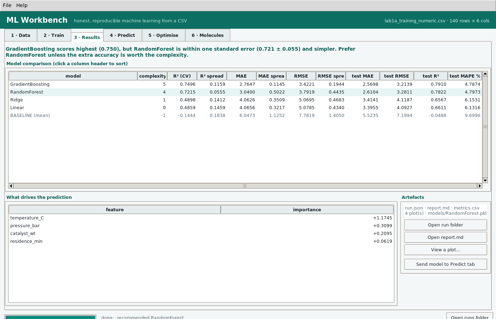

# ML Workbench

A no-code machine-learning workbench for tabular CSV data and molecules — built to close the
gaps that make GUI ML tools like **EZmachinelearning** frustrating: no baseline to compare
against, preprocessing that is not saved with the model, silent data-quality failures, no
honest holdout, no record of what was run.

Windows desktop app · Python 3.11 · scikit-learn · RDKit · single `.exe` · completely offline.

> **New here? Read [`docs/MLWorkbench_User_Guide.pdf`](docs/MLWorkbench_User_Guide.pdf)** — 82 pages,
> written for readers with no machine-learning background: foundations in plain language, ten
> step-by-step tutorials on the bundled sample data, and a reference for every tab, model and output
> file.



---

## The gaps it fixes

| Gap in the original tool | What ML Workbench does |
|---|---|
| One-hot encoder is never saved, so training and prediction drift apart | Every model is a full scikit-learn `Pipeline` — impute → one-hot → scale → estimator — pickled as **one object**. Prediction cannot disagree with training. |
| No baseline, so "R² = 0.72" has nothing to mean | A `DummyRegressor` / majority-class classifier is **always trained and shown** in the results table. |
| Missing values crash or silently drop rows | Median / most-frequent **imputation inside the pipeline**, plus an audit that tells you which columns are too sparse to save. |
| No leakage checks | The audit flags identifier-like columns, duplicate rows, target-copy features (>0.995 correlation), constant columns, numeric-looking text, whitespace/case label drift. |
| Hyperparameters tuned invisibly | Explicit `RandomizedSearchCV` with a budget you set; the chosen parameters are written into `run.json` and `report.md`. |
| No honest final number | Optional stratified **holdout** never used for tuning, reported in its own columns. |
| No time-series support | **`TimeSeriesSplit`**, group-aware CV, and a lag/rolling feature builder (forecasting in a few clicks). |
| Only "which model won" — no interpretation | **Permutation importance** (own implementation, works with named columns) and coefficients for linear models, with plots. |
| You cannot rebuild the experiment next month | Every run writes a folder: `run.json` (all settings, seed, library versions, **sha256 of the data**), `report.md`, `metrics.csv`, `plots/`, `models/`. |
| Grid files in a bespoke `step`/`array` format | Range-based **optimiser** with boundary and extrapolation warnings. |
| Population of results with one perfect score, no warning | 1-SE model selection: it recommends the **simplest** model within one standard error of the best, and says so in words. |
| No applicability domain | Prediction-time **range checks**, unseen-category counts, flagged extrapolation rows; Tanimoto similarity for molecules. |
| No molecule standardisation | Salts/mixtures reduced to the largest fragment, canonical SMILES, unparsable rows **reported** rather than silently blank. |
| GUI only | Full **CLI** (`mlw train / predict / optimise / audit / smiles`) for scripts and CI. |

---

## Get the app

**Windows:** download `MLWorkbench.exe` (113 MB, one self-contained file) from the
[Releases page](../../releases) and double-click it. There is nothing to install —
Python, scikit-learn, matplotlib and RDKit are bundled inside — and nothing to
download afterwards. SmartScreen warns once because the binary is unsigned
(“More info” → “Run anyway”). The app has no network code: nothing leaves the machine.

To confirm the download is intact (the same hash is printed in the user guide):

```
certutil -hashfile MLWorkbench.exe SHA256
db745979458c7ee6c5b75bc263cbb9661c2b450814f3e18dbe76a3ac3f30aa7e
```

Windows SmartScreen will warn once because the exe is unsigned ("More info" → "Run
anyway"). The app has no network code: nothing leaves the machine.

### How this binary was verified

Built with PyInstaller 6.22 on Python 3.11.9 with numpy 1.26.4 / pandas 2.2.3 /
scikit-learn 1.5.2 / matplotlib 3.9.2 / RDKit 2026.9.1, then executed:

```
MLWorkbench.exe --selftest  ->  SELFTEST ok: True
                                train:   RandomForest (140 rows, CV + holdout)
                                predict: 5 rows -> predicted_yield
                                optimise: 50 candidates
                                molecules: 3 molecules -> 16 columns
```

That run exercises the engine inside the frozen bundle: pipeline training with
cross-validation, model save/load, prediction, grid optimisation, RDKit descriptors.
The GUI was launched from the same binary and a CSV opened through it
(`docs/screenshots/00_windows_exe.png`). Build traps (numpy 2 vs Wine, joblib workers
inside a frozen app) are documented in [`docs/BUILD_NOTES.md`](docs/BUILD_NOTES.md).

Prefer a folder build with 3-second startup? `build_windows.bat` produces
`dist/MLWorkbench/MLWorkbench.exe` in `--onedir` form; that variant was built and tested
here too — it is just too large to ship.

### Run from source instead

```bash
python -m pip install -r requirements.txt
python run_mlworkbench.py          # desktop app
python run_mlworkbench.py audit data.csv   # CLI
```

---

## Seven-minute tour

**1 · Data** — `Open CSV…`. Encoding and delimiter are detected. Pick the target column;
the task (regression vs classification) is inferred from the column itself. Untick anything
that must not be a feature. Read the health-check list: red = must fix, amber = judgement.

**2 · Train** — the ★ models are the sensible defaults for the detected task. Set folds,
seed, search budget; keep **holdout** ticked for an unbiased number. Press **Run training**
and watch the log.

**3 · Results** — the table is sorted by the primary metric with the **baseline pinned** in
the list. The recommendation line tells you which model to use and why (usually "the simpler
one, it is within one standard error"). Double-click a row for per-fold scores, chosen
hyperparameters and the holdout score. Everything is also on disk.

**4 · Predict** — point at the saved `.pkl` and a new CSV. The model carries its own
preprocessing; you get predictions plus probability columns for classifiers. Rows outside
the training range are marked as extrapolation, unseen categories are counted.

**5 · Optimise** — "Load ranges" fills min/max from the training data. Sweep, rank by
predicted response, and read the two warnings: *boundary* (best point on the edge → the true
optimum is probably outside the grid) and *outside training range* (the model is guessing).

**6 · Molecules** — SMILES → 15 descriptors or Morgan/RDKit fingerprints, with
standardisation, then "Check applicability domain" against the training molecules.

---

## Command line

```bash
mlw audit data.csv --target yield
mlw train data.csv --target yield --search 20 --holdout 0.2
mlw train data.csv --target grade --models Logistic,RandomForest --balance
mlw train sales.csv --target sales --lag 1,2,7 --group store --sort-by date --time-series
mlw predict runs/xxx/models/RandomForest.pkl new.csv -o predictions.csv
mlw optimise runs/xxx/models/RandomForest.pkl --maximise \
              -r temperature_C:70:110:9 -r pressure_bar:1:5:5 -o candidates.csv
mlw smiles molecules.csv --column SMILES --mode morgan --bits 2048 -o features.csv
```

`MLWorkbench.exe <args>` runs the same commands (it attaches to the calling console).

---

## What a run folder contains

```
runs/20261110_172714_reactor/
├── run.json                  # every setting, seed, metric, library version, data sha256
├── report.md                 # human-readable summary — the thing you paste into a lab book
├── metrics.csv               # the comparison table
├── feature_importance.csv
├── holdout_predictions.csv   # actual vs predicted on untouched rows
├── models/RandomForest.pkl   # preprocessing + estimator, one object
└── plots/
    ├── predicted_vs_actual.png
    ├── confusion_matrix.png
    ├── residuals.png
    ├── correlation.png
    └── importance.png
```

Re-use a model in plain Python without this app:

```python
import joblib, pandas as pd
bundle = joblib.load("models/RandomForest.pkl")
model  = bundle["pipeline"]           # imputation + encoding included
print(model.predict(pd.read_csv("new.csv")[bundle["features"]]))
```

---

## Build it yourself

```bat
build_windows.bat
```
or, without touching Python, push the repo to GitHub: `.github/workflows/build-exe.yml`
builds the exe on a Windows runner and uploads it as an artifact.

---

## Honest limitations

- **Not a replacement for a notebook** when you need custom features, text/image models,
  survival analysis or Bayesian inference. Use it for the 80 % of tabular work that is
  screening, comparison and prediction.
- **Hyperparameter search and scoring share folds**, so CV scores are mildly optimistic.
  The holdout column is the unbiased number — that is why it is opt-in but strongly suggested.
- **Trees, fingerprints and descriptor models cannot extrapolate.** The app warns you; it
  cannot fix it.
- The **optimiser predicts**, it does not experiment. Confirm top conditions for real.
- Molecule descriptors are RDKit's; standardisation is deliberately simple (largest fragment).
  Tautomers and charges are not normalised — call a cheminformatics library if that matters.
- The `.exe` is unsigned; SmartScreen will complain the first time.

---

## Layout

```
mlworkbench/
├── run_mlworkbench.py     # launcher: GUI by default, CLI with arguments
├── mlw/
│   ├── core.py            # engine: audit, pipelines, CV, selection, predict, optimise, SMILES
│   ├── plots.py           # all figures (Agg backend)
│   ├── gui.py             # tkinter desktop app
│   ├── cli.py             # command line
│   └── __main__.py        # python -m mlw
├── tests/
│   ├── smoke.py           # end-to-end core test, no GUI
│   └── gui_shot.py        # headless GUI drive + screenshots
├── assets/icon.ico
├── build_windows.bat
└── .github/workflows/build-exe.yml
```

---

## License

MIT — see [LICENSE](LICENSE). The bundled `sample_data/` is synthetic and free to use.
